<div align="center">

# AGENTGATE Studio

**A private coding agent that lives on your Mac.**<br>
Pick a model, click Install, open a folder, and ask. The model runs on your Mac, the agent works inside an OS sandbox, and every command and edit passes a gate before it runs.

[](https://github.com/Rizsaurav/agentgate-studio/actions/workflows/verify.yml)


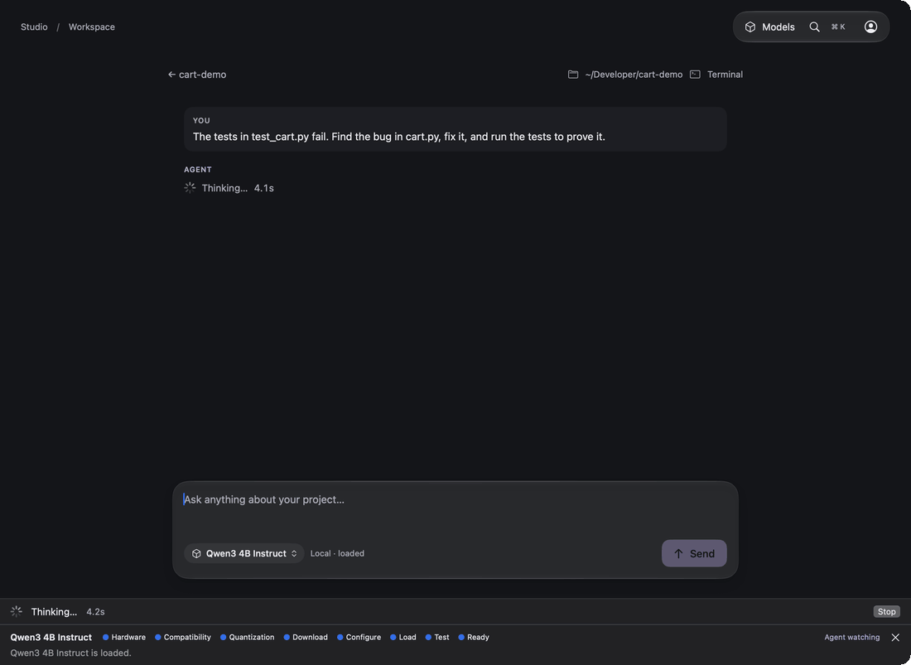

<sub>A real recording, sped up. Qwen3 4B on a MacBook Air (M5, 24 GB) reads the code, asks before it edits, recovers when <code>python</code> is missing, and proves the fix with the tests. 44 s end to end, and nothing left the Mac.</sub>

</div>

---

## Why it exists

Coding agents are useful and a little scary. Most send your code to someone else's servers, and the ones that run locally hand a language model a shell with your rights. Running a model locally has its own tax: which model fits this machine, which quantization, how much context, why the engine just ran out of memory.

AGENTGATE Studio addresses both:

- **Local models feel like an app, not a project.** The app reads your Mac's memory and GPU limits, picks the quantization and context that fit, downloads with resume and checksums, loads the model, and proves it can answer and call tools before it says Ready.
- **The agent is fenced, and you can see everything.** It runs inside a macOS Seatbelt sandbox, every tool call is checked by rules before you are asked, and the chat shows each command with its live output and exit code, each edit as a diff, and each refusal with the reason the model was given.

## Highlights

|                                        |                                                                                                                                                                                                                                                  |
| -------------------------------------- | ------------------------------------------------------------------------------------------------------------------------------------------------------------------------------------------------------------------------------------------------ |
| **Optimize a repo in rounds**          | Give the agent a goal, or press "Optimize this repo", and it keeps going: one small, verified change per round, until it reports the goal met, says it needs you, or stops itself after three rounds that change nothing.                        |
| **One click to a working local model** | A pure, deterministic planner sizes the model to this Mac. An eight-step install (Hardware, Compatibility, Quantization, Download, Configure, Load, Test, Ready) is visible as it runs, survives a quit or crash, and resumes where it stopped.  |
| **Agent orchestration you can watch**  | The app runs three processes, the model engine, the agent harness and itself, and turns the harness's event stream into a live transcript: reasoning, commands, output, diffs, approvals and refusals in the order they happened.                |
| **A gate on every tool call**          | Four layers: call validation, policy rules, your approval, and the OS sandbox underneath. A refused call tells the model why, so it corrects itself instead of stopping.                                                                         |
| **Fast on a laptop**                   | A lean agent configuration cut the prompt from 14.6K to 3.7K tokens: first answer in **4.5 s instead of 27.5 s** on a 4B model.                                                                                                                  |
| **Installs that repair themselves**    | When a step fails, a supervising agent may propose fixes, but only from a fixed list of operations. Every proposal is checked, risky ones wait for you (no answer in 10 minutes, adjustable, counts as no), and everything goes to an audit log. |
| **CI/CD in the same window**           | A project's GitHub Actions runs, jobs and steps are read live through `gh`, with the failure excerpt one click from "Fix with agent".                                                                                                            |

## Screenshots

<table>
<tr>
<td width="50%">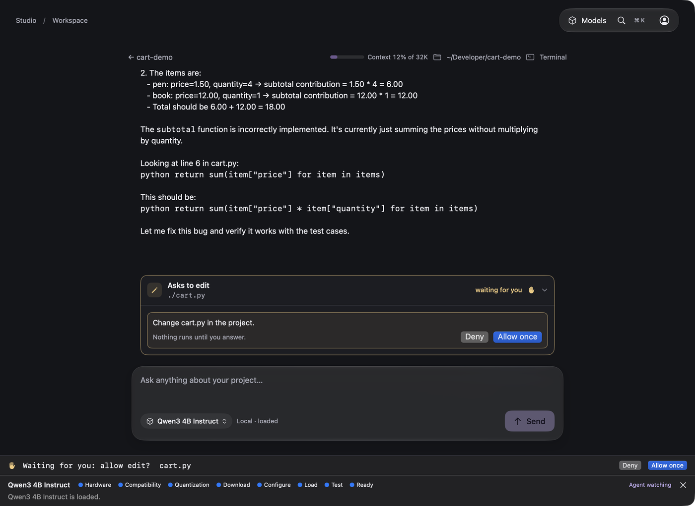<br><sub><b>Ask before acting.</b> The question appears on the step it is about. Nothing runs until you answer.</sub></td>
<td width="50%">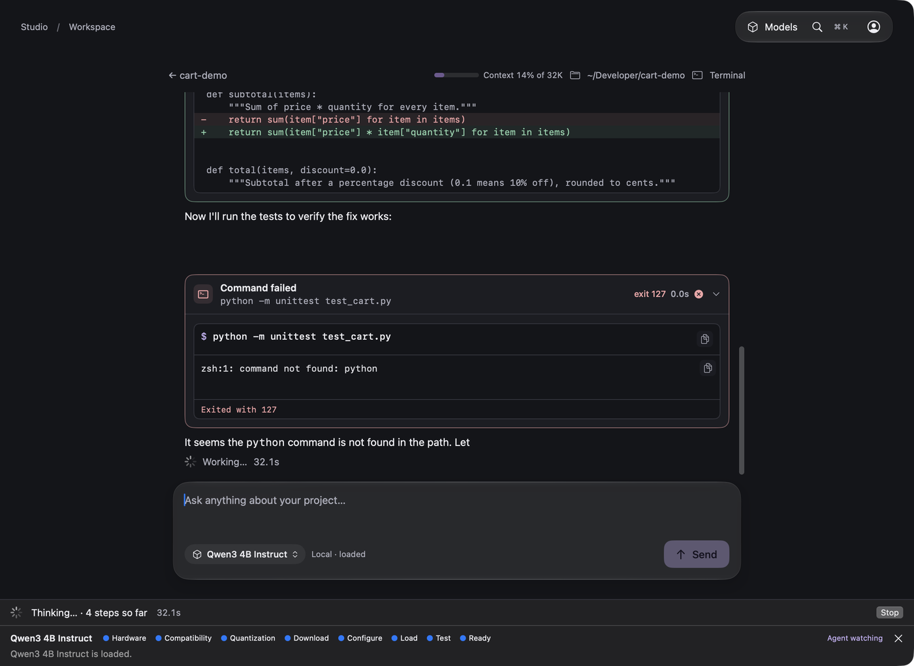<br><sub><b>Every step, as it happened.</b> The edit as a diff, then a command that failed with exit 127. The model reads the error and retries with <code>python3</code>.</sub></td>
</tr>
<tr>
<td width="50%">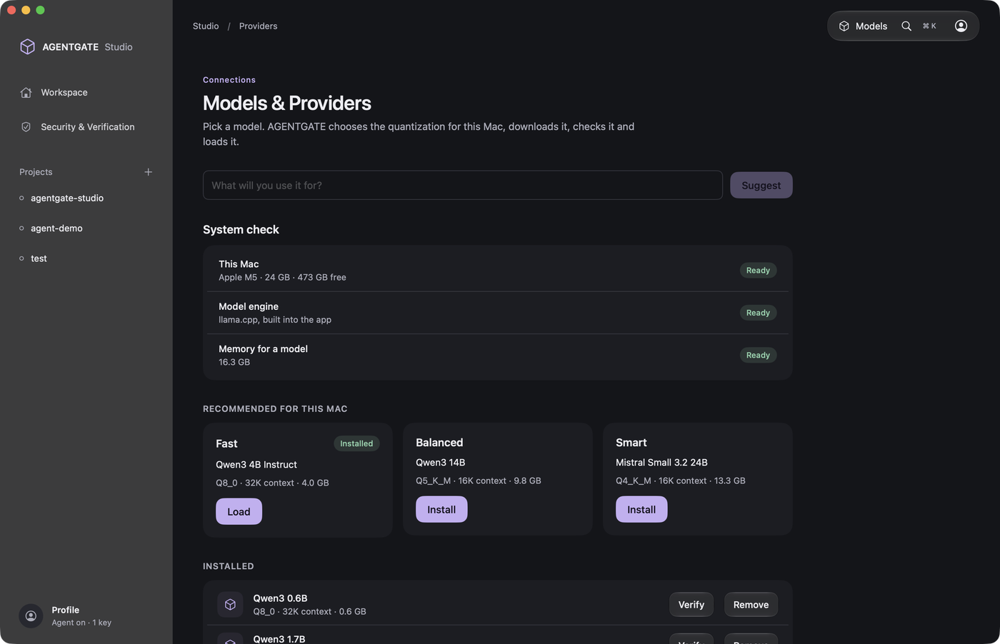<br><sub><b>Models sized to this Mac.</b> A system check, then Fast, Balanced and Smart picks with the quantization, context and size already chosen.</sub></td>
<td width="50%">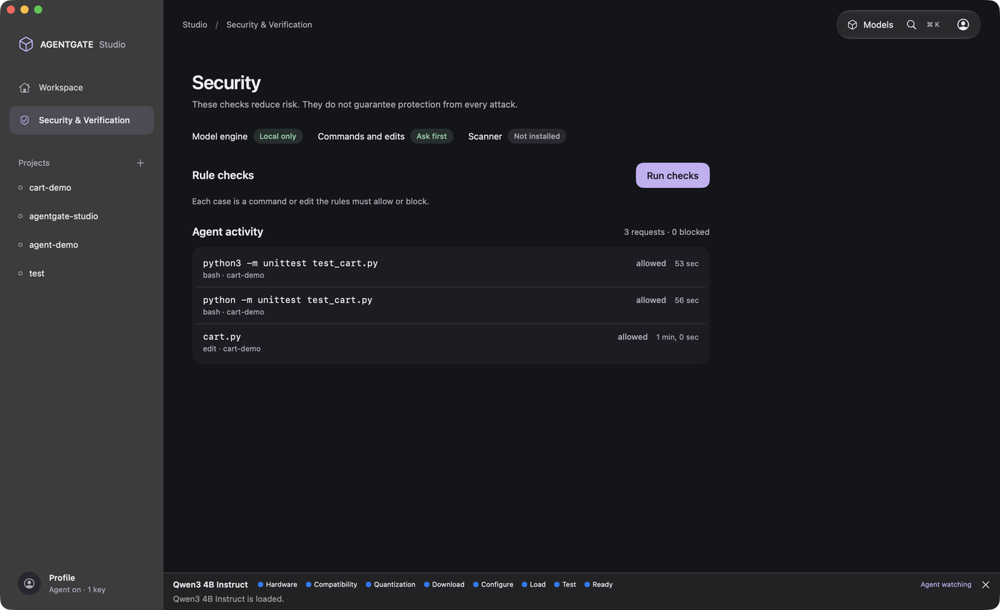<br><sub><b>Rules you can test.</b> A 28-case self-test of the rules, and a log of every request the agent made in the recording above, with its verdict.</sub></td>
</tr>
</table>

## Optimize a repo in rounds

Open a project and AGENTGATE reads it first: languages, size, branch, last commit, and the command that checks it (`swift test`, `npm test`, `cargo test`, `go test ./...`, `pytest` and more). Press **Optimize this repo**, or type any objective and press **Goal**, and the agent works toward it in rounds.

<div align="center">
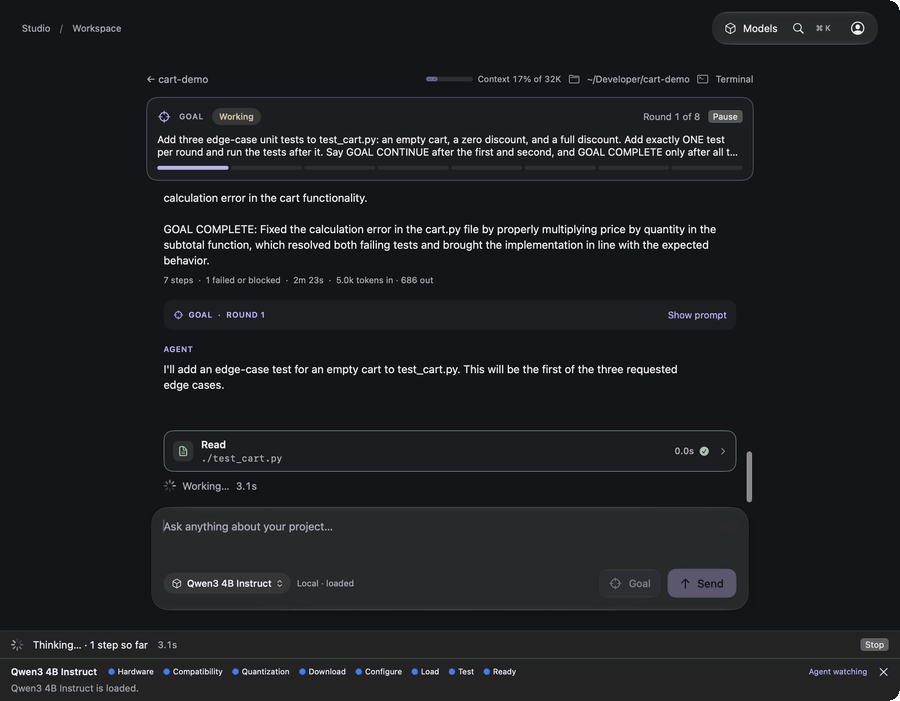
<br><sub>A real three-round goal, sped up: one new edge-case test per round. Rounds 2 and 3 start on their own, every edit and command still waits for approval, and the goal completes at round 3 of 8.</sub>
</div>

<table>
<tr>
<td width="50%">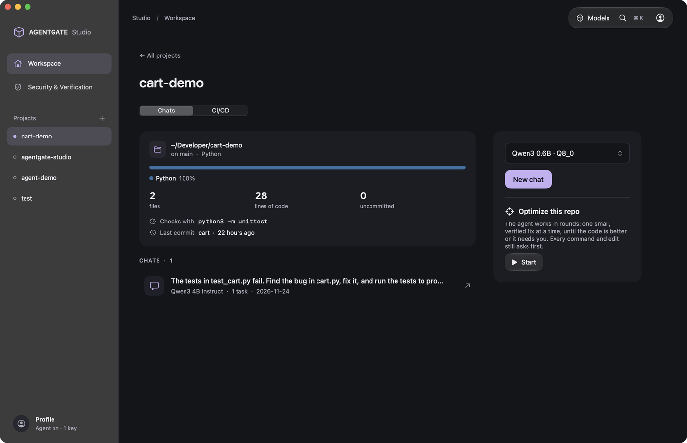<br><sub><b>The repo at a glance.</b> Languages, lines of code, uncommitted files, the check the agent will use, and one button to start.</sub></td>
<td width="50%">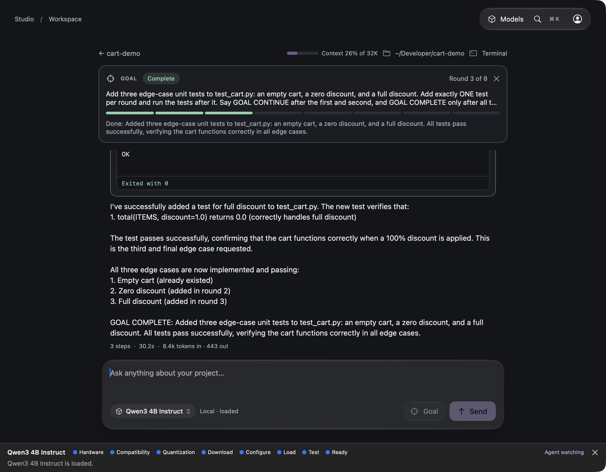<br><sub><b>Every round is visible.</b> The track fills as rounds run; the banner shows the phase, the rounds used and the agent's own summary.</sub></td>
</tr>
</table>

How the rounds work:

- **One objective per chat, saved with it.** A goal survives a restart. Its phase is always one of four: active, paused, blocked or complete.
- **The app drives the rounds, not the model.** When a turn ends, the app reads the last line of the answer: `GOAL COMPLETE`, `GOAL BLOCKED` or `GOAL CONTINUE`. Any model that can follow an instruction can run a goal; no special tools are needed.
- **It stops on its own.** A round cap (8 by default, up to 50), three rounds in a row with no file changed, a failed round, or Stop all end the run, and the banner says why. Pausing stops the round in progress.
- **The workspace is the authority.** Each round tells the model to trust the current files and tool results, not what earlier rounds claimed.

The design follows the goal service and round driver of [DeepSeek Harness](https://github.com/deepseek-ai/deepseek-harness) (MIT), rebuilt in Swift for this app: one durable goal, rounds started only when the agent is idle, a hard round cap, and a stop after repeated rounds without progress.

## Quick start

Needs an Apple Silicon Mac with macOS 14 or later and the Swift 6 toolchain (Xcode 16 or later).

```sh
git clone https://github.com/Rizsaurav/agentgate-studio && cd agentgate-studio/mac
./scripts/build_app.sh                 # fetches pinned, checksum-verified llama.cpp and OpenCode, builds the app
open "dist/AGENTGATE Studio.app"
```

Then, inside the app:

1. **Models**: press Install on the pick marked for this Mac. Watch the eight steps; the model is tested before it is offered.
2. **Workspace**: open a project folder (a git repository works best).
3. **Ask**: "The tests fail. Find the bug, fix it, and run the tests." Approve or deny each command and edit as it comes.

The build is ad-hoc signed for your own Mac. A signed and notarized DMG is on the [roadmap](#roadmap).

## How it works

### Architecture

The app is the orchestrator. It owns the model engine and the agent harness as child processes, talks to both over loopback HTTP with a fresh secret per launch, and decides every tool call itself.

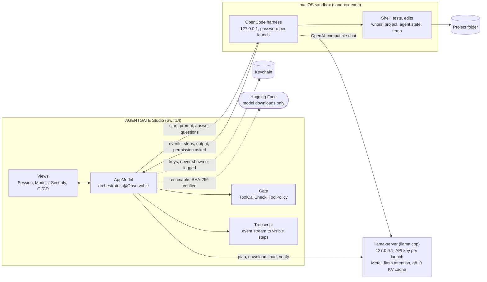

### One tool call, end to end

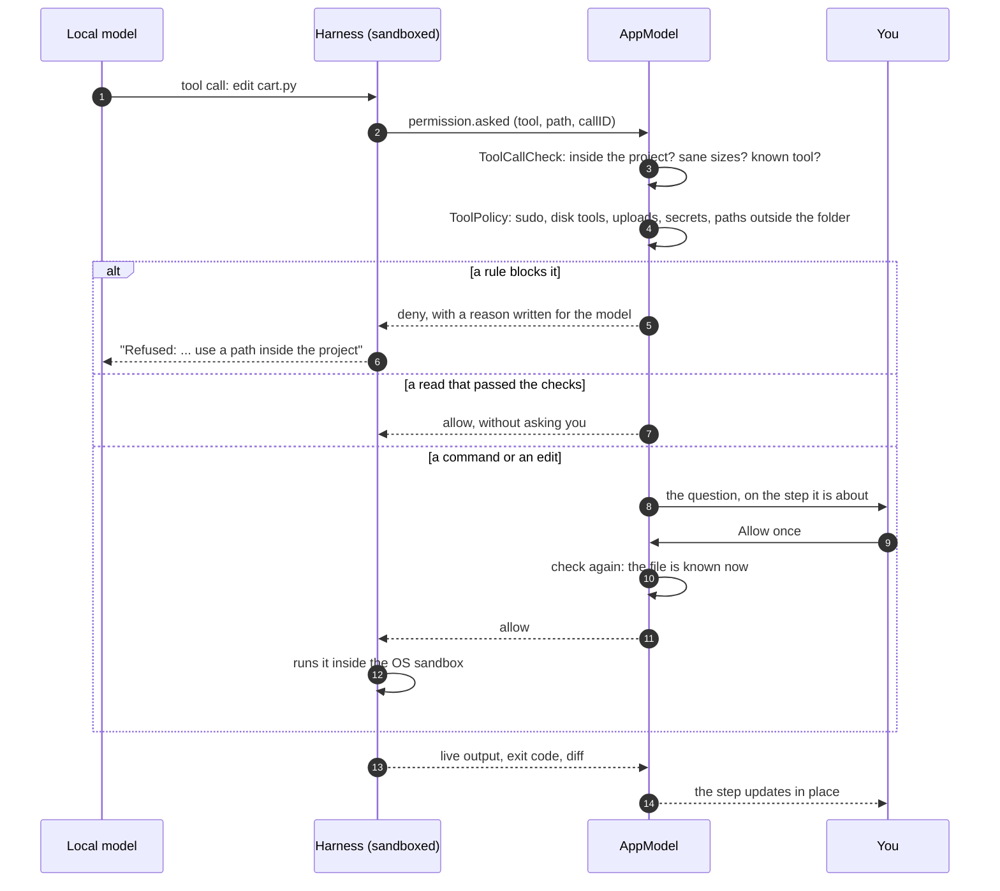

### Defense in depth

No single layer is trusted on its own. Each catches what the others cannot see.

| Layer                                    | Where                | What it stops                                                                                                                                                                                                           |
| ---------------------------------------- | -------------------- | ----------------------------------------------------------------------------------------------------------------------------------------------------------------------------------------------------------------------- |
| **1. Call validation** (`ToolCallCheck`) | Before anything else | Unknown tools, malformed or oversized arguments, NUL bytes, paths and globs that leave the project. Reads that pass run without bothering you.                                                                          |
| **2. Policy rules** (`ToolPolicy`)       | Commands and edits   | Privilege escalation, disk and process tools, remote shells, `eval`-style execution, uploads, secrets such as `.ssh`, `.aws` and `.pem`, writes outside the project.                                                    |
| **3. Your approval**                     | Commands and edits   | Every command and edit waits for you, on its own step, in plain words ("Change cart.py in the project"). Nothing runs until you answer, and an edit is checked again at the moment you approve, when its file is known. |
| **4. OS sandbox** (`AgentSandbox`)       | The kernel           | Every process the harness starts may write only to the project, its own state and temp folders, and cannot read key folders, whatever the first three layers missed.                                                    |
| **Prompt-injection stop**                | Tool output          | A tool result that reads like instructions to the model stops the turn and says why.                                                                                                                                    |

Every decision lands in a private security log (mode 0600, redacted, no file contents). These checks reduce risk; they do not guarantee protection from every attack.

### How a model is fitted to your Mac

The planner is a pure function, `plan(model, for: profile) -> Compatibility`: the same catalog entry and the same Mac always give the same plan, so it is unit-tested without a GPU.

1. **Budget.** `min(RAM - system reserve, GPU working-set limit) - 1.5 GB` for the harness. The system reserve grows with the Mac (3.5 GB below 12 GB, 8 GB from 40 GB up). A 24 GB M5 gets 16.3 GB.
2. **Memory per candidate.** `weights + KV cache + overhead`, where the KV cache is `2 x layers x kv_heads x head_dim x context x bytes per element`. The cache is q8_0 (1.0625 bytes) unless the head size is not a multiple of 32, in which case llama.cpp needs f16 and the plan pays for it.
3. **Choice.** The best quantization that fits at a 16K context wins (8K if nothing fits at 16K), then the context grows to 32K if that still fits. The plan must also leave 2 GB of disk free, and it says why in plain words: _"Q8_0 with a 32K context: the best quality that fits the 16.3 GB this Mac has for a model."_

The context the planner chose also sizes the agent: room for the reply, a compaction reserve, recent turns kept verbatim, and a cap on any single tool result (`ContextBudget`).

### State machines

<table>
<tr>
<td width="50%">

**Model install**

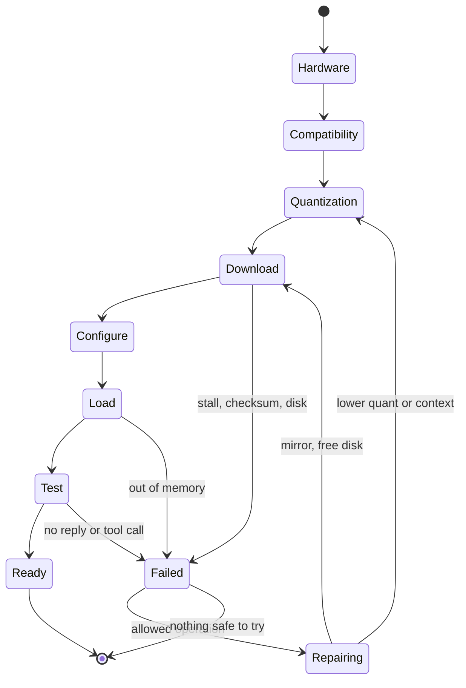

</td>
<td width="50%">

**One agent step**

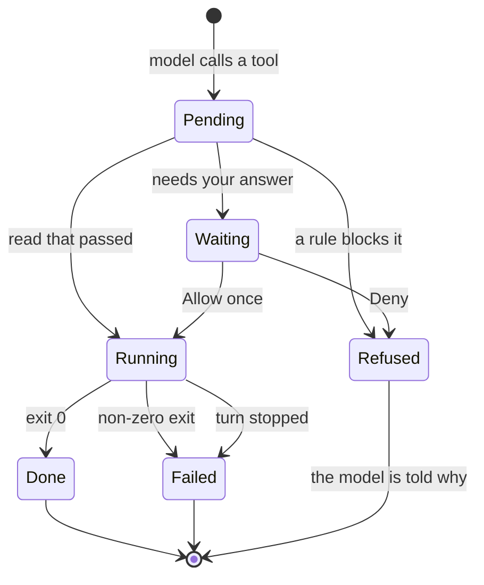

</td>
</tr>
</table>

**A goal**

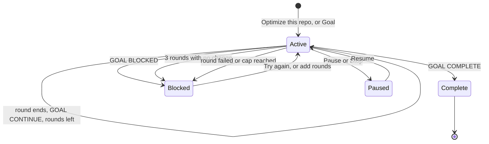

### Structure

The Mac app follows Model, View, Controller. `AgentGateCore` is the model layer: no UI imports, every rule and algorithm in plain value types, tested directly. The `AgentGateStudio` target holds the SwiftUI views and two observable controllers.

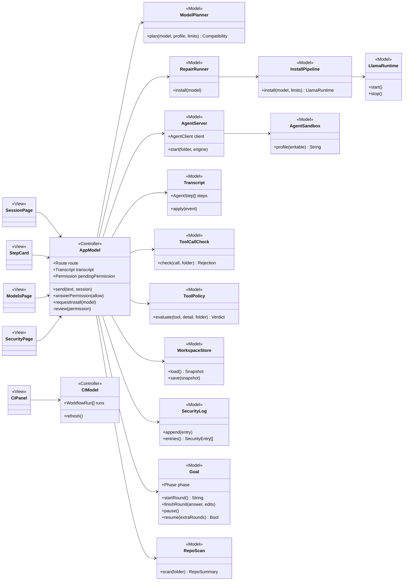

## Performance

Measured on a MacBook Air (Apple M5, 24 GB) with Qwen3 4B Instruct, Q8_0, 32K context.

| What                                                                 |        Before |            After |
| -------------------------------------------------------------------- | ------------: | ---------------: |
| Prompt the model reads before its first answer                       | 14,634 tokens | **3,735 tokens** |
| Time to the first word of an answer                                  |        27.5 s |        **4.5 s** |
| The bug-fix task in the recording above (5 steps, 1 self-correction) |               |       **43.9 s** |

What made the difference:

- **A lean agent.** The harness's general prompt and the tools this app never uses (sub-agents, to-do lists, web fetch) were about 11K tokens read before every first answer. The app replaces them with a short prompt of its own.
- **No background work.** Language servers, formatters and per-step git snapshots are off.
- **An engine tuned for one user.** Metal offload of every layer, flash attention, a q8_0 KV cache (half the memory of f16), and one slot, so the prompt prefix stays cached between the calls of a turn.

## Quality

- **245 Swift tests** across 44 suites (17 of them live, run with `AGENTGATE_LIVE=1`): the planner, goal rounds, the repo scan, downloads (resume, stalls, checksums), the install matrix, repair policy, every rule in the gate, the sandbox profile, and the transcript, including recorded approval events.
- **Recorded fixtures.** The transcript tests replay real event streams recorded from the harness, so a harness update that changes its events fails a test instead of the app.
- **Live tests on demand.** `AGENTGATE_LIVE=1 swift test` downloads a real model, loads it, chats, and starts the real harness behind its password.
- **CI on every pull request:** the Mac app's build and tests on macOS, typecheck, lint, unit tests and production build for the web app, security evaluations, a Docker smoke test, and browser end-to-end tests.
- **Pinned and verified dependencies.** llama.cpp `b11765` and OpenCode `v1.19.5` are fetched by tag and checked against SHA-256 before use.

## What leaves your Mac

By default, only model downloads. Everything else is something you turn on or approve.

| When you                                          | What is sent                                                                                                                                              | To                                             |
| ------------------------------------------------- | --------------------------------------------------------------------------------------------------------------------------------------------------------- | ---------------------------------------------- |
| Install a model                                   | A request for the model file                                                                                                                              | Hugging Face                                   |
| Chat with the agent                               | Nothing from the app: the model runs on this Mac. Commands you approve can use the network (a package install, for example); uploads are blocked by rule. | Whatever that command contacts                 |
| Turn on the supervising agent for failed installs | A failure report with keys and private paths removed, plus any web searches it makes                                                                      | The provider you chose (OpenRouter by default) |
| Let a repair switch the download source           | A request for the model file                                                                                                                              | hf-mirror.com                                  |
| Open a project's CI/CD tab                        | Requests for that repository's workflow runs, with your `gh` login                                                                                        | GitHub                                         |

Keys live in the macOS Keychain, are checked once with their provider, and are never shown again or logged.

## Repository layout

```text
mac/                     The native app (this README)
  Sources/AgentGateCore/   Model layer: planner, installer, engine, harness, gate, transcript, goals, repo scan
  Sources/AgentGateStudio/ Views and controllers (SwiftUI)
  Tests/AgentGateCoreTests/ 245 tests, recorded harness fixtures
  scripts/                 build_app.sh, pinned runtime fetchers, catalog builder
apps/web/                The web app (Next.js): RAG over project documents, prompt-injection scanner, evaluations
packages/controller/     The web app's controller: runs, documents, protection pipeline, SQLite
scanner/                 LLM Guard prompt-injection scanner (Python)
evals/                   Promptfoo security evaluations
desktop/                 Electron shell for the web app
docs/                    Web app architecture and performance, process, install test matrix
```

The repository also holds a cross-platform **web app**: agent sessions on Ollama or cloud models with shared project context, retrieval over reference documents, an LLM Guard scanner that fails closed, and Promptfoo evaluations in CI. How to run it with Docker or from source is in [docs/WEB_APP.md](docs/WEB_APP.md).

## Roadmap

- [x] Local models sized per Mac, with a visible, resumable, self-repairing install
- [x] Sandboxed agent with a four-layer gate and every step in the chat
- [x] Lean harness: first answer in 4.5 s on a 4B model
- [x] Goals: optimize a repository in rounds, with a repo overview on every project
- [ ] Instant first answer: load the model at launch and keep the prompt cache on disk
- [ ] Speculative decoding with a small draft model
- [ ] A native Swift agent loop in place of the bundled harness
- [ ] Signed and notarized DMG with automatic updates
- [ ] One product: the web app's retrieval and evaluations in the native app

## Docs

[Web app architecture](docs/ARCHITECTURE.md) · [Web app performance budgets](docs/PERFORMANCE.md) · [Install test matrix](docs/INSTALL_TEST_MATRIX.md) · [Web app](docs/WEB_APP.md) · [Contributing](CONTRIBUTING.md) · [Process](docs/PROCESS.md) · [Engineering rules](AGENTS.md)
